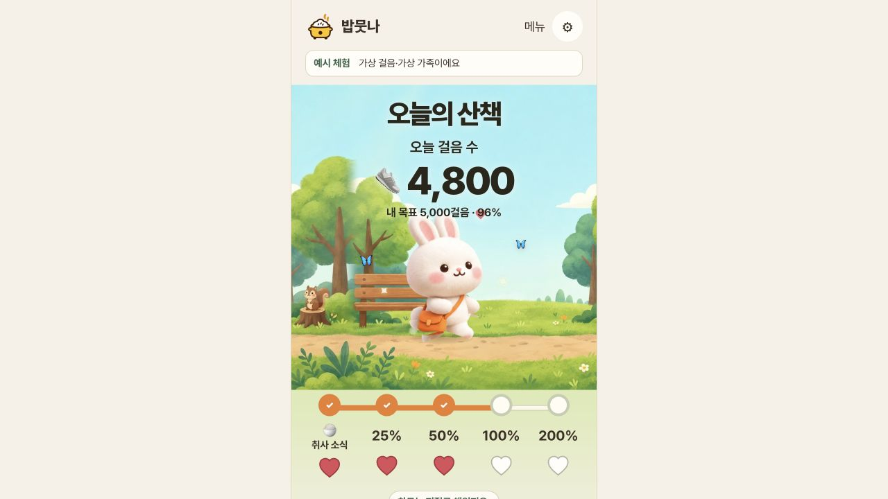
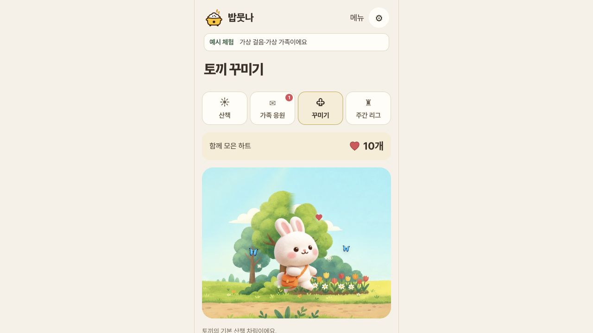

# GitHub 소스와 현재 Firebase 게시본 대조 — 2026-11-19

## 어디에 올라가 있는가

팀 저장소는 `seungju5/-1`이다. 11월 19일 `main` 반영 전 다음 원격 브랜치와 커밋을 확인했다. [GitHub 저장소](https://github.com/seungju5/-1)

| 구분 | 원격 브랜치 / 커밋 | 상태 |
| --- | --- | --- |
| 기본 브랜치 | `main` / `d0f40da` | 최신 작업 미병합 |
| 로그인·온보딩 등 | `codex/google-kakao-login` / `989a7c7` | [PR #3](https://github.com/seungju5/-1/pull/3) 열림 |
| 초기 Firebase 통합 | `codex/connect-firebase-bapmunna` / `7eadd5a` | [PR #1](https://github.com/seungju5/-1/pull/1) 열림 |
| 안티그래비티 보강 포함 최신 소스 | `codex/walking-hearts-20261117` / `efbdd94` | 원격에 이미 업로드됨; 조회 당시 main보다 92개 커밋 앞섬 |
| 이 채팅의 삼성 검증 기록 | `codex/smartthings-completion-20261117` / `06942b0` | 원격에 이미 업로드됨 |

`efbdd94`에 `06942b0`의 검증 문서를 병합한 통합본을 기본 브랜치 `main`에 반영했다. 안티그래비티가 추가한 앱 코드, 디자인, 애니메이션, 자산과 기존 `main` 커밋 이력을 보존했다. [GitHub main](https://github.com/seungju5/-1/tree/main)

## 현재 Firebase에 있는 내용

확인 URL: [밥뭇나 앱](https://impact-series.web.app/bapmunna/app/) · [메뉴](https://impact-series.web.app/bapmunna/app/more/) · [산책 체험](https://impact-series.web.app/bapmunna/app/walking/demo/)

- 운영 릴리스: `sites/impact-series/versions/c6ac5c6b3663fc35`
- 게시 시각: **2026-11-18 16:57:56 KST**
- 11월 19일 조회와 파일 대조 중 운영 릴리스가 바뀌지 않았음을 확인했다.
- 최종 게시 때 변경된 **150개 파일을 공개 URL에서 내려받아 보관본과 바이트 단위로 대조**했다. 모두 일치했다.
- 보관본과 현재 로컬 산출물 중 Hosting 해시가 일치하는 파일을 합쳐 **현재 활성 `/bapmunna/` 산출물 381개·앱 HTML 26경로**를 보존했다. 총 38,753,228바이트다. 이전 배포에서 남은 미사용 chunk까지 전체 웹사이트를 복제했다는 의미는 아니다.
- 파일별 SHA-256과 Hosting 해시, 검증 범위는 [게시본 대조 영수증](../workspaces/bapmunna-final/releases/20261119-github-sync.json)에 있다.

현재 게시본에는 다음 보강이 들어 있다.

| 내용 | 소스 이력 |
| --- | --- |
| 산책 하트, 가족 응원, 토끼 옷장, 선택 리그 | `e740ac8` |
| 관절을 나눠 움직이는 토끼, 3D 차림과 산책 효과 | `a9bffcf` |
| 두 장면의 공원 파노라마와 문구 배치 | `0865444` |
| SmartThings 기기 정보 카드, 홈·연결 화면과 시연 동기화 | `f69279a` |

운영 브라우저에서 더보기의 ‘오늘의 산책’, ‘산책 하트·가족 응원·토끼 꾸미기’, 기기 연결 경로와 산책 체험의 다섯 단계·가족 응원·꾸미기·주간 리그 메뉴를 확인했다. 예시 체험의 걸음수와 가족은 실제 수신 증거로 사용하지 않았다.

과거 릴리스 영수증은 배포 준비 당시 HEAD인 `887ebf6`을 기록한다. 이후 `f69279a`가 연결 카드 등 작업 내용을 커밋했다. 따라서 과거 영수증의 커밋 번호만으로 ‘수정 없는 깨끗한 소스에서 빌드됐다’고 단정하지 않는다. 이번에는 실제 게시 파일 해시를 별도로 대조했다.

## GitHub에는 있지만 아직 Firebase에 없는 추가분

최신 `efbdd94`에는 전력 전사·단계별 해석 화면과 관련 모델, 컨트롤러, 검사, 동기화 스크립트가 포함되어 있다. 이 코드도 `main`에 포함했다.

그러나 이 커밋으로 만든 11월 19일 로컬 산출물은 현재 게시본과 다르다. 381개 중 245개는 Hosting 해시가 같고, 새 경로 9개와 달라진 경로 127개가 있다. HTML/RSC의 빌드 식별자 변경도 포함되므로 127개를 모두 새 기능 파일이라고 해석하지 않는다. **현재 Firebase에 전력 전사·해석 화면까지 게시됐다고 보고하지 않는다.**

## 실제 연결 검증에서 구분할 부분

아래는 삼성 연결 화면과 데이터 처리 코드의 검토 결과다.

- 공개 서버의 `/api/smartthings/config`는 HTTP 200, `enabled:true`, **`connectionReady:false`**다. 신규 소비자 OAuth 연결이 열린 상태가 아니다.
- `useSmartThingsSyncController.ts`의 수동 동기화는 `updateDemo`로 브라우저 체험 기록을 만든다. 실제 삼성 API 요청이나 자동 웹훅 수신과 구분해야 한다.
- `SmartThingsAccountCard`는 기본 기기 프로필과 연결 완료 문구를 사용한다. 이 표시만으로 사용자의 실제 연결 완료를 증명할 수 없다.
- 추가 전력 전사·해석 컨트롤러에는 고정 예시 수치가 있다. 이 값들을 실측 전력이나 AI가 실제 분석한 결과로 발표하지 않는다.
- `sync-smartthings-owner-plug.mjs`에는 개인 환경 경로·고정 시험 계정·fallback이 있어 이번 대조에서는 실행하지 않았다. 현재 게시본 보존과 별개로 운영용 동기화 경로는 검토가 필요하다.

위 사항은 이번에 새로 구현하거나 활성화한 기능이 아니다. Firebase DB·사용자 정보·운영 비밀값·결제·기기 상태는 변경하지 않았다.

## 검증 및 팀 인계

`main`에 반영한 앱 실행 코드와 자산은 `efbdd94`와 같다. 추가분은 통합 안내, 게시 파일 검증 결과, 이전 삼성 계정 검증 기록이다.

- 루트320·전력 패턴141·개인정보48·Firebase85·하네스27개 통과. 타입·공통 코드/디자인 동기화·계약·정적 산출물·Next 빌드·소스 안정성 검사도 통과했다.
- 서버군 첫 실행은 localhost 포트에 대한 샌드박스 `EPERM` 1개로 실패했다. 서버 패키지 전체를 로컬 포트 허용 후 재실행하여 **131개 통과·실패0·건너뜀13개**를 확인했다. 13개는 Auth/Firestore emulator 미기동 통합검사다. 초기 failed 보고서를 덮어쓰거나 건너뛴 검사를 성공에 포함하지 않았다. 전체 패키지에는 처음 하네스에서 선택한 서버 검사 외의 하트 검사도 포함된다.
- 보존 산출물의 26개 앱 HTML에서 직접 참조하는 로컬 정적 자산 누락은 0개다.
- 이번 검사에서 실제 삼성 사용자 OAuth·실물 플러그·토큰 갱신/철회·2–3가구 격리·휴대폰 건강 API는 실행하지 않았다.

현재 게시된 화면 증거:

이미 저장소를 받은 팀원은 `main`으로 전환한 뒤 `git pull --ff-only origin main`으로 받을 수 있다.
