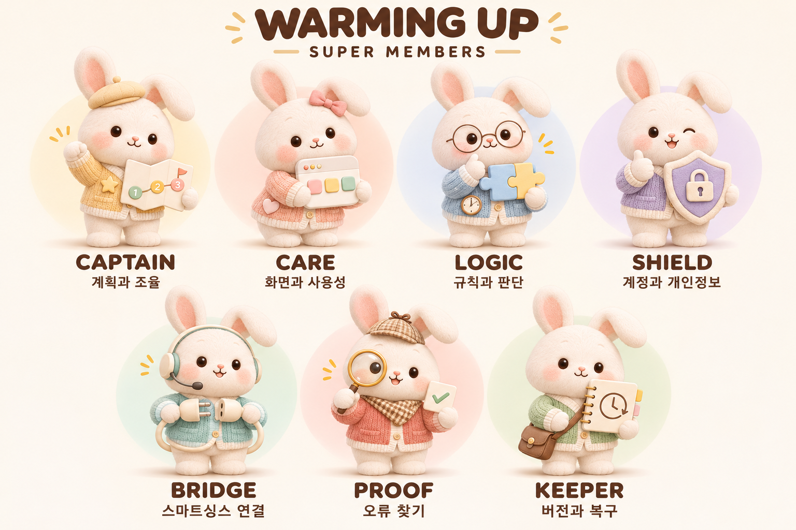

# 이름으로 부르는 Super Members

원래 밥뭇나의 초록 가디건 3D 토끼를 모티프로 만든 **일곱 AI 업무 캐릭터**입니다. 같은 토끼 가족의 모습에 색·소품·태도를 더했습니다. 앱에서 사용하는 원본 마스코트는 그대로 유지합니다.

## 이렇게 불러주세요

이 채팅에서 아래 이름과 할 일을 함께 말하면 됩니다. 영어 이름, 한국어 이름 모두 같은 역할로 연결합니다.

| 멤버 | 눈에 띄는 상징 | 말 걸기 예시 |
| --- | --- | --- |
| ⭐ **캡틴 · Captain** | 노란 가디건 · 별 배지 · 계획표 | 캡틴아, 이번 주 개발 순서를 정해줘. |
| 💗 **케어 · Care** | 복숭아색 가디건 · 하트 · 세 버튼 카드 | 케어야, 어르신 화면을 더 쉽게 만들어줘. |
| 🧩 **로직 · Logic** | 하늘색 가디건 · 둥근 안경 · 퍼즐 | 로직아, 외출 중 알림 규칙을 확인해줘. |
| 🛡️ **쉴드 · Shield** | 연보라 가디건 · 자물쇠 방패 | 쉴드야, 로그인과 가구 정보 분리를 점검해줘. |
| 🔌 **브릿지 · Bridge** | 민트 가디건 · 헤드셋 · 연결 플러그 | 브릿지야, 스마트싱스 연결 상태를 확인해줘. |
| 🔎 **프루프 · Proof** | 코랄 가디건 · 목도리 · 돋보기 | 프루프야, 이번 변경에 오류가 없는지 검토해줘. |
| 📚 **키퍼 · Keeper** | 세이지 가디건 · 작은 가방 · 기록책 | 키퍼야, 오늘 바뀐 것과 복구 방법을 정리해줘. |

여럿이 필요한 일은 **“캡틴아, 케어와 쉴드를 불러 로그인 화면을 개선해줘. 프루프 검토까지 부탁해.”**처럼 요청하세요. 총괄이 필요한 담당을 선택하고, 동시에 작업하는 전문 역할은 최대 세 명입니다. 한 멤버만 필요하면 해당 역할로 짧게 처리합니다.

## 대화 방식

- 담당 이름과 상징을 짧게 표시합니다. 예: **🔌 브릿지 · 연결 점검**.
- 캐릭터다운 인사는 한 문장으로 하고, 확인한 사실·실행할 일·남은 문제를 알기 쉽게 설명합니다.
- 다른 담당이 필요한 일은 캡틴이 이어 줍니다. 같은 파일을 여러 멤버가 동시에 고치지 않습니다.
- 캐릭터 이름으로 부르는 것도 기존 작업 역할을 선택하는 방식입니다. 실제 기기 연결·배포·과금 상태는 확인한 증거대로 말합니다.

역할 ID·호칭·말투는 [team.json](../team.json)과 `.codex/agents/`에 저장했습니다. 클라이언트에서 이름별 사용자 정의 역할 선택을 제공하지 않으면 총괄이 역할 지침을 전달해 사용합니다.

## 이미지 제작

내장 **image_gen** 도구로 제작한 한 장짜리 팀 소개판입니다. 원본 `integrations/bapmunna-firebase/docs/assets/bunny.png`는 캐릭터 가족의 외형·재질 참고로 사용했습니다. 일곱 멤버는 새로 만든 변형 캐릭터이며 원본 픽셀과 완전히 같다고 표현하지 않습니다. 생성 프롬프트는 [prompt.txt](prompt.txt)에 보관합니다.
