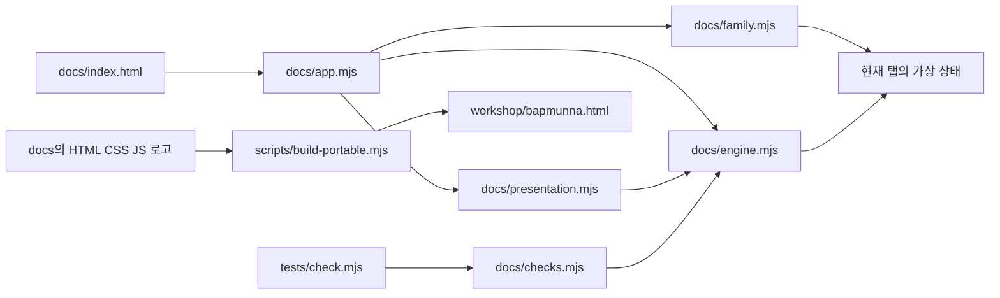

# ADT · 아키텍처 결정과 데이터·타입 기록

버전: 0.3 · 작성일: 2026-10-16

파일명은 사용자 요청을 유지한다. 이전 Skill의 약어 확장은 미확인이다. 아래는 **현재 구현**과 **후속 설계**를 구분한 기록이다.

## 현재 구조



- UI는 화면·폼·대화상자를 다루고 엔진의 상태 변경 함수를 호출한다.
- 엔진은 끼니·신호·시계·외출·연결·공유 규칙을 계산한다.
- 같은 엔진을 Node 검사와 화면 내 검사에서 사용한다.
- 이 가상 체험 구조와 별도로 계정·DB 어댑터를 추가했다. 가족 체험 화면 전환은 계속 같은 메모리 객체를 읽는다.

## 결정 기록

| ID | 결정 | 근거와 결과 | 상태 |
| --- | --- | --- | --- |
| D-01 | 기존 정적 ES module 구조 유지 | 초기 프로토타입 복원·워크숍 편집을 우선. 가상 엔진은 외부 의존성 없이 실행, 인증 SDK는 별도 번들 | 적용 |
| D-02 | 신호와 직접 확인을 별도 필드로 유지 | WS-1의 ‘밥솥 사용 ≠ 식사’ 원칙. 센서 입력으로 manual을 설정하지 않음 | 적용 |
| D-03 | 데모 상태는 탭 메모리에서 유지 | 가상 데이터·빠른 초기화. 다중 사용자 공유와 영구 저장을 제공하지 않음 | 적용 |
| D-04 | 초대·역할별 요약을 같은 탭에서 체험 | 일회용·만료·교체·연결 해제를 검사. 실제 인증·권한·동기화는 별도 구현 | 데모 적용·실서비스 후속 |
| D-05 | 원문 MoSCoW와 MVP O/X를 보존 | 기존 도움·다른 가전 데모가 있어도 제품의 필수 범위를 새로 확정하지 않음 | 문서 적용 |
| D-06 | 비공개 원본과 별도로 정적 체험을 제공 | 승인받은 프런트엔드만 배포 | [통합판 배포 이력](deployment.md) |

## 현재 상태 모델

아래 타입은 설명용이며 TypeScript 소스가 추가되었다는 뜻은 아니다. 정확한 실행 정의는 [engine.mjs](../docs/engine.mjs)를 따른다.

```ts
type Meal = 'breakfast' | 'lunch' | 'dinner';
type MealRecord = {
  manual: boolean;
  sensor: boolean;
  exempt: boolean;
  eatOut?: boolean;
};
type DeviceState = {
  online: boolean;
  watts: number;
  lastActivity: number | null;
  onlineSince: number;
};
type MealStatus = 'private' | 'confirmed' | 'unobserved' | 'away'
  | 'upcoming' | 'signal' | 'waiting' | 'offline' | 'missing';
```

| 상태 영역 | 의미 |
| --- | --- |
| now, config | 데모 분 단위 시계와 식사 시간·유예 |
| profile, rules | 거주·선택 기기·식사 습관과 데모 알림 규칙 |
| records | day:meal별 직접 확인·신호·외출 제외 요약 |
| devices | 연결, 순간 전력, 마지막 활동·관찰 시작 시각 |
| deviceDays, observedDays | 일별 기기 집계와 관찰한 날짜 |
| alerts, careAlerts | 끼니 알림과 안부·연결·도움의 화면 내 상태 |
| sharedFrom, lastMealAt | 공유 관찰 시작과 마지막 자기보고 시각 |
| help, social, warmth | 현재 탭의 도움·관계·마음 요청 |
| family | 가상 별명·역할·수락 시각, 일회용 초대·만료, 코드 순번. 실제 인증 아님 |
| processed, discarded | 가상 이벤트 처리·폐기 카운터 |

`DAY=1440`이며 시계·시간대 값은 데모의 분 단위다. 표시 기준일은 2026-10-07이다. 실제 서버의 타임스탬프·사용자 시간대를 그대로 대체하는 스키마가 아니다.

## 상태 전이와 보존

직접 확인은 해당 끼니를 `manual`로 표시한다. 센서 입력은 신호 요약을 남기며 원시 이벤트 배열을 쌓지 않는다. 외출과 연결 장애는 별도로 처리한다. 공유 중지는 요약·시각·요청을 지우고, 재개 후 중지 기간을 소급해서 분류하지 않는다.

현재 최근 30일의 끼니 요약과 일별 집계를 정리하며, 마지막 활동·확인 시각도 유지한다. 이 값은 원시 이벤트 배열과 다른 파생 데이터이지만 사생활과 무관한 정보라는 뜻은 아니다. 운영 버전에서는 목적·접근·보존·삭제를 각 필드와 백업까지 정해야 한다.

## 후속 구조의 결정 항목

실기기 이벤트 수신과 중복 식별, 사용자·가족 관계와 역할 검증, 요약 저장, 스케줄러·푸시 전달 기록을 설계한다. 이벤트 ID, 재전송, 권한 철회, 삭제 전파를 검증해야 한다. 개인 계정·직접 식사 확인·CRM의 테이블과 Firebase/Supabase 공급자는 v0.3에서 추가했다. 가족 공유·IoT·푸시의 운영 구조는 아직 확정하지 않았다.

## v0.2 추가 결정

- D-07: Figma A의 시작 화면, C의 큰 선택과 연락 구조, B의 밥그릇 자산을 조합한다. 정적 이미지의 출처·슬롯은 assets.md에 기록한다.
- D-08: 밥의 양은 증거 종류의 시각 표현이다. 직접 확인·신호·빈 기록을 건강이나 섭취량으로 환산하지 않는다.
- D-09: 초대 코드는 가상 시계 24시간 만료, 일회용이며 새 초대로 교체한다. 역할별 요약은 필드 허용목록을 사용한다. 서버 보안을 제공하는 것으로 표현하지 않는다.
- D-10: 공유 중지 시 가족 연결·초대·외출·마음 상태도 지운다. 재개는 새 관찰과 새 연결로 시작한다.
- D-11: public 접근은 프런트엔드와 로그인 없는 가상 체험에 적용한다. 개인 데이터와 CRM에는 인증·권한 검사를 적용한다. GitHub 저장소의 private 상태와 인증 범위를 바꾸지 않는다.

## v0.3 추가 결정

- D-12: `account-view.mjs`가 공통 로그인·개인 기록·CRM UI를 제공하고 `cloud-api.mjs`가 배포별 공급자를 고른다. 가상 엔진의 상태를 읽어 업로드하지 않는다.
- D-13: Auth/비밀번호, 개인 프로필·식사, 고객 기본정보, 운영 메모, 운영자 역할을 분리한다. Firebase rules와 Supabase RLS로 서버 권한을 강제한다. 상세 스키마는 [database.md](database.md).
- D-14에서는 Firebase와 Supabase 인증·저장소를 분리하고 동기화 없이 각 공급자의 계정을 사용하기로 했다.
- D-15에 따라 당시 Firestore 규칙은 게시 전 컴파일·에뮬레이터 검사에서 같은 소스를 사용했는지 해시로 대조했다. 현재 통합판은 루프백 에뮬레이터로 검증한다.
- D-16: Supabase 기본 SMTP 제한을 인증 생략으로 우회하지 않는다. 사용자가 custom SMTP를 설정하고 허용한 정확한 콜백 URL만 적용한다.
- D-17: 계정 UI의 재렌더링 후에도 이벤트 경로로 cloud surface를 구분해 데모 전역 클릭 처리기가 계정 탭·폼을 초기화하지 않게 한다.

## 간소화·완전한 저장 계약 추가 결정

- D-18: 사용자 선택에 따라 Firebase를 기본 Auth·DB로 유지한다. Supabase는 별도 버전이며 유료 요금제·Functions·새 결제 연결을 추가하지 않는다.
- D-19: 최신 홈·기록 참조 이미지를 정보 순서에 반영한다. 하단 메뉴 3개, 목적별 설정 펼침, 간단한 계정 폼으로 줄인다.
- D-20: Supabase 14개 테이블·집계 뷰·가족 요약 RPC와 Firestore의 16개 문서 경로 계약·조회 인덱스를 만든다. UI 연결 상태는 DB 준비 상태와 구분한다.
- D-21: Firebase 공유 중지는 epoch를 바꿔 과거 권한을 무효화한다. Supabase는 공유 행을 제거한다. 두 방식 모두 개인 식사와 운영자 CRM을 가족 공유로 노출하지 않는다.
- D-22: 배포 전 소스와 staging 파일의 SHA-256을 고정하고 게시 파일을 대조한다. 슬래시 없는 기본 경로도 재검증 캐시 정책을 적용해 이전 HTML과 새 모듈이 섞이지 않게 한다.


## 관리센터 구성

`account-view.mjs`가 인증·확인된 운영자 접근을 통제하고, 허용된 세션에서만 `manage/dashboard.mjs`를 마운트한다. 로그아웃·계정 전환 시 컨트롤러와 메모리의 고객 정보를 폐기한다. `manage/metrics.mjs`는 두 공급자의 날짜를 정규화하고 한국 날짜 집계·필터·페이지 중복 제거를 처리한다. 서버 역할 판정은 기존 Firebase 규칙·Supabase RLS를 유지한다. 차트 라이브러리나 새 서버 서비스는 추가하지 않았다.

## ADR · 두 사용자 버전, 공통 구현

독립 앱 소스나 별도 사용자 DB를 만들지 않고 `/senior/`, `/carer/` 진입 페이지를 생성한다. 역할별 화면 정책은 `editions.mjs`, 데이터 권한은 기존 서버 규칙에 둔다. URL·브라우저 선택값은 권한 근거가 아니다. 공급자별 base를 보존하고 기존 인증 콜백을 사용한다. 역할 선택값만 경로별로 보관하며 실제/가상 사용자 자료는 담지 않는다. [상세](editions.md).

## v1.1 시뮬레이터 결정 · 2026-10-16

`power.mjs`는 raw 샘플 배열 없이 연속성/상태/구간 집계 여부만 유지한다. `worksheet.mjs`는 설정을 복제 상태에서 검증한 후 원자적으로 적용하고, 가상 날짜와 14일 비교를 제공한다. `lastLidAt`은 다른 활동과 분리한다. 오프라인·외출·공유 중지는 미사용 추정과 분리하고 재관찰 기준을 갱신한다. 상세 가정·경계는 [v1.1](worksheet-v11.md)을 따른다.

## 화면 전환 접근성 · 2026-10-16

공통 헤더의 두 `data-edition` 링크가 기존 `switchEdition` 라우팅을 사용한다. 현재 선택에는 `aria-current`를 주고 동일 선택은 no-op 처리한다. 화면 선택은 로컬 프레젠테이션 상태와 URL만 바꾸며 DB 역할·로그인·동의·가상 기록을 수정하지 않는다. 공통 HTML로부터 두 진입점을 재생성하며 공급자 경계는 `editionLink`가 유지한다.
